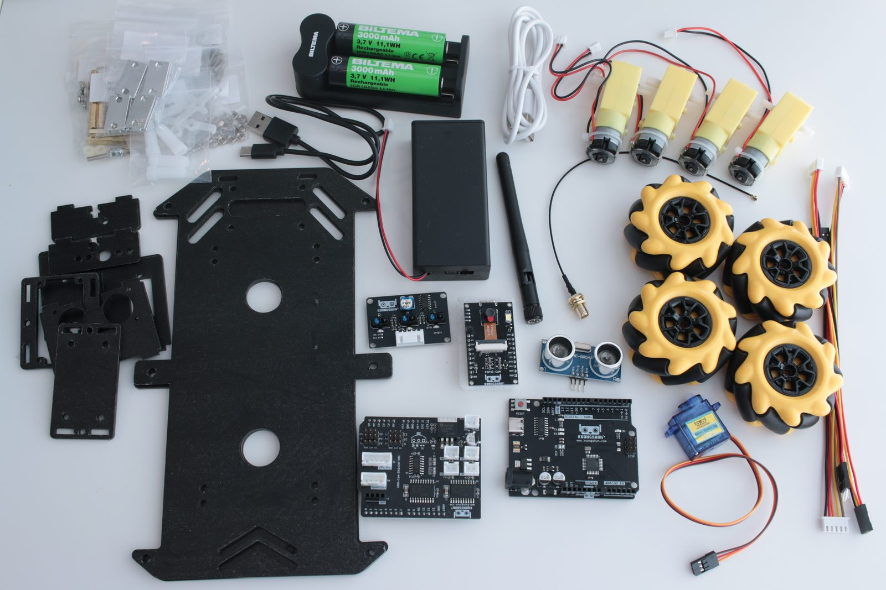
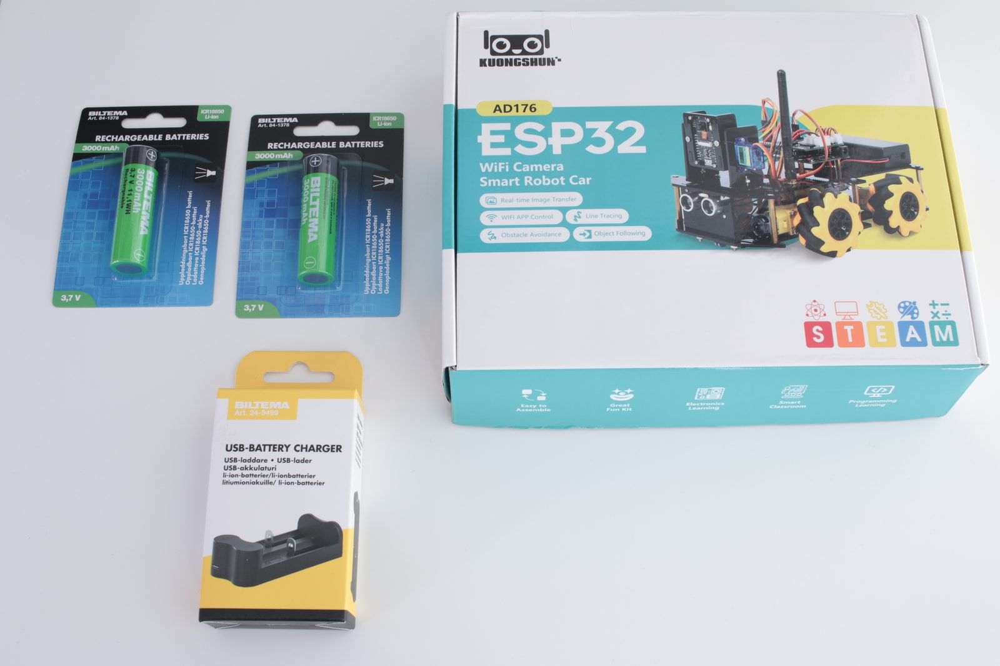

# Scout

Scout lets an AI assistant see through a small robot car and drive it around your home.
It works with Grok Bot, Claude Code and OpenAI Codex, from anywhere: you don't need to be
on the same WiFi network as the car.



> **Status:** early development. The server and firmware are written and tested in
> simulation; testing on the real car is next.

## What you can do with it

- **Find things.** "Look under the sofa for my keys."
- **Check on the house.** "Is the front door closed?"
- **Gather pictures for 3D modelling.** Scout circles an object and saves full-size
  photos you can download and use in Blender.
- **Follow the cat** (gently, and not too close).
- **Just drive it around.** It has mecanum wheels, so it can move sideways and
  diagonally as well as forwards and back.

## How it works

```
AI assistant ──MCP──▶ Scout server ◀──WebSocket── car (ESP32-CAM + UNO)
```

The car connects out to the Scout server and keeps that connection open. AI assistants
talk to the server using MCP (Model Context Protocol), and the server passes their
commands to the car and sends back pictures and sensor readings. Every movement is short
and time-limited, and the car stops by itself if anything goes wrong.

More detail: [architecture](docs/architecture.md), [hardware](docs/hardware.md),
[protocols](protocol/README.md).

## What you need

- A KUONGSHUN AD176 ESP32 WiFi camera robot car kit (the mecanum-wheel version).
- Two 18650 Li-ion cells and a charger. They aren't included in the kit.
- A 2.4 GHz WiFi network with a normal password.



## Using Scout

1. Sign in on the Scout website with your GitHub account.
2. Wait for an admin to activate your account.
3. On your account page, create a token and copy the ready-made command for your AI
   assistant.

The website's install page has the exact steps for Grok Bot, Claude Code, OpenAI Codex
and the grok CLI.

### Tools the AI gets

| Tool | What it does |
|---|---|
| `status` | Whether the car is online, its sensor readings and who's driving |
| `look` | Takes a picture, optionally tilting the camera or turning on the light first |
| `move` | Drives forward, back, sideways or diagonally for up to 3 seconds |
| `turn` | Turns left or right by roughly the given angle |
| `drive` | Combines forward, sideways and turning movement directly |
| `set_light` | Sets the white LED |
| `stop` | Stops at once |
| `look_around` | Turns in steps and returns all the views in one picture |
| `capture_photo` | Saves a full-size photo to a capture set you can download |
| `capture_orbit` | Circles the object in front and photographs it from all sides |
| `follow` | Follows a cat, dog or person for a while |
| `release_car` | Lets someone else drive |

## Repository layout

| Folder | Contents |
|---|---|
| [`firmware/scout_uno`](firmware/scout_uno) | UNO firmware: motors, tilt, sensors, safety stops |
| [`firmware/scout_esp32cam`](firmware/scout_esp32cam) | ESP32-CAM firmware: camera, WiFi setup, server link, updates |
| [`firmware/libraries/ScoutLink`](firmware/libraries/ScoutLink) | The serial framing both boards share |
| [`firmware/tests`](firmware/tests) | Host-side unit tests for the firmware |
| [`server`](server) | The Scout server (website, accounts, MCP, car link) and the simulated car |
| [`protocol`](protocol) | The two link protocols and shared test vectors |
| [`tools`](tools) | Bench tool for testing the UNO from a PC |
| [`docs`](docs) | Architecture, hardware and deployment notes |

## Building and testing

Firmware unit tests (needs CMake and a C++ compiler):

```
cmake -S firmware/tests -B build/firmware-tests
cmake --build build/firmware-tests
ctest --test-dir build/firmware-tests --output-on-failure
```

Server (needs [uv](https://docs.astral.sh/uv/)):

```
cd server
uv sync
uv run pytest
```

The firmware builds with the Arduino IDE or `arduino-cli`; see the README in each
firmware folder for board settings and flashing. CI runs all of this on every push.

## Safety and privacy

- New accounts can't reach the car until an admin approves them.
- Only one person drives at a time, and admins can always stop the car.
- Every movement is time-limited on the car itself, and the car stops when it loses its
  connection or sees something close in front.
- Anyone you approve can see inside your home through the camera, so only approve people
  you trust.

See [SECURITY.md](SECURITY.md) for how to report a security problem.

## License

[MIT](LICENSE). Scout is an independent project and isn't affiliated with or endorsed by
KUONGSHUN.
