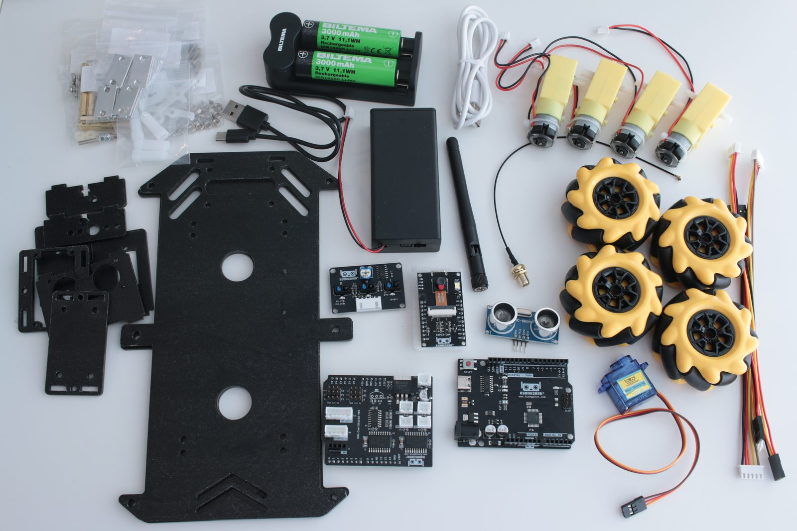
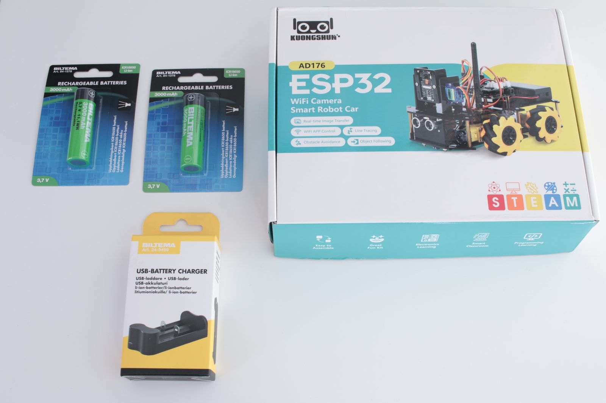

# Hardware

Scout runs on the KUONGSHUN AD176 "ESP32 WiFi Camera Smart Robot Car" kit with mecanum
wheels. Everything here comes from inspecting the boards and from testing. Items marked
*unverified* still need measuring on a real car.

## Boards

| Board | What it is | Role in Scout |
|---|---|---|
| Arduino UNO clone | ATmega328P, CH340C USB, USB-C | Motors, tilt servo, distance and line sensors, safety stops |
| UNO-Cam-Shield-V01 | 74HC595 shift register, two L293DD motor drivers, LM1085 5 V regulator | Sits on the UNO and powers everything from two 18650 cells |
| ESP32-CAM-V2.0 | ESP-32S module (4 MB flash), CH340C USB, USB-C, auto-reset | Camera, WiFi, link to the server |
| Camera | Ribbon marked "XY0033-3660-B", most likely an OV3660 (*unverified*) | Forward-facing camera |
| PSRAM | SOP-8 chip marked "6404H", most likely 8 MB PSRAM (*unverified*) | Frame buffers for larger images |

The UNO and the ESP32-CAM talk over a 4-wire cable (VCC, GND, RX, TX) at 115200 baud.
Both boards' USB ports share those same serial lines, so **unplug that cable before
flashing either board**.

## UNO pins (through the shield)

| Pin | Use |
|---|---|
| D2 | 74HC595 shift clock |
| D4 | 74HC595 latch |
| D7 | 74HC595 output enable, active low. A 10 kΩ pull-up keeps the motors off until the firmware drives it low |
| D8 | 74HC595 data |
| D5, D6 | Motor speed (PWM): D5 the two right wheels, D6 the two left ones (measured) |
| D9 | Camera tilt servo (KS-9GMS, SG90 class). Level is a servo angle of 81°; at 90° the camera points about 9° up |
| D12, D13 | Ultrasonic sensor trigger and echo (forward-facing) |
| A0, A1, A2 | Three downward-facing line sensors (which side is which is *unverified*) |
| D10, D11 | Free |
| A4, A5 | I²C (SDA, SCL) to the optional laser distance sensor (below). The shield labels this header for a gyroscope |
| A3 | Free, reserved for battery sensing |

## Motors

Four geared DC motors with mecanum wheels: M1 front-left, M2 rear-left, M3 front-right,
M4 rear-right. The shift-register bit map and the mixing formula are in
[protocol/uart.md](../protocol/uart.md).

### Speed on the floor

Measured on a hard floor with a tape measure, driving through the server's `move` and
`turn` tools:

- From a standstill a motor only starts at a PWM duty of about 100. At 60, 75 and 90
  the wheels hummed and the car stayed put; at 105 it moved 14 cm in 1 s. `min_pwm` is
  set to 110 on the admin page (the firmware default is 90).
- Once it runs, a motor's speed grows with its duty from about 25 (out of 255), but not
  in a straight line: the turning speed sags around 80 % and picks up again at 100 %,
  where the pin stays on all the time. The firmware maps 1..100 % onto `min_pwm`..255,
  so speed isn't proportional to the percentage either: 20 % is far more than a fifth
  of full speed. The server uses the measured turning speeds as a table, with straight
  lines between them (`MEASURED_TURN_RATES` in `server/src/scout/robot/motion.py`);
  forward and sideways use the same shape.

| Move | `min_pwm` | Duty | Measured | Model |
|---|---|---|---|---|
| Forward 1.5 s at 20 % | 90 | 122 | 28.2 cm (18.8 cm/s) | 18.4 cm/s |
| Forward at 30 %, the obstacle-stop run | 90 | 138 | about 54 cm in 2.5 s (21.5 cm/s) | 21.4 cm/s |
| Forward 1 s at 50 % | 90 | 172 | 28 cm | 28.4 cm/s |
| Forward 1 s at 80 % | 110 | 226 | 35 cm | 35.9 cm/s |
| Sideways 1 s at 50 % | 90 | 172 | rear wheels 25 cm, front 23.5 cm | 24.2 cm/s |
| Turn at 20 % | 110 | 138 | 85° in 0.85 s, 88° in 0.89 s (twice) | 99.4°/s |
| Turn 1 s at 50 % | 90 | 172 | 132° | 132°/s |
| Turn at 80 % | 110 | 226 | 84° in 0.5 s, 165° in 1 s | 166.5°/s |
| Turn 1 s at 100 % | 110 | 255 | 202° | 202°/s |

The model column uses the calibration that fits these runs: 202°/s turning, 43.5 cm/s
forward and 37 cm/s sideways at 100 %. The turns are the table's own points; the 80 % forward
run, measured afterwards, confirms forward follows the same shape. With a straight
line through 25 instead, the 80 % turns came out 8 % short. Sideways moves yaw
slightly counter-clockwise. A forward move at 30 % from 65 cm stopped at 14 cm with the
obstacle distance at 15 cm.

## ESP32-CAM pins

| GPIO | Use |
|---|---|
| 1, 3 | Serial link to the UNO (and USB) |
| 4 | White flash LED |
| 33 | Small red status LED (active low) on AI-Thinker boards; none to be seen on the AD176's ESP32-CAM-V2.0 |
| 0, 5, 18, 19, 21, 22, 23, 25, 26, 27, 32, 34, 35, 36, 39 | Camera |

## Camera

Measured on the car from pictures of a person of known height standing 200 cm in front,
taken at three tilts, using where their head and feet appear:

| | Measured |
|---|---|
| Field of view | about 65.5° top to bottom, so about 81° across (the picture is 4:3) |
| Tilt | settings of 0, 20 and 40 put the camera at about −1°, 17° and 34° up: 0.88° per degree |

The server uses both (`camera_hfov_deg` and `camera_tilt_scale` in the robot config) to
turn a box in the picture into a direction. The servo arm is a push fit on the shaft. If
the camera is knocked it can jam, or go back on a tooth or two out; three pictures at
tilts 0, 20 and 40 that look the same, or a tilt of 0 that doesn't look straight ahead,
show it.

## Laser distance sensor (optional)

A VL53L1X time-of-flight sensor on a small breakout board (marked "VL53L0/1XV2") can sit on
the camera's tilt panel, facing forward like the lens. It then measures the distance to
the middle of the picture wherever the camera points, and it sees people and soft things
(clothes, legs, curtains) that the ultrasonic sensor often misses. In long distance mode
it reaches about 3.5 m in the dark and less in bright light, with a cone about 27° wide.

The board has its own regulator and a two-MOSFET level shifter on SDA and SCL with
pull-ups to VIN, so it takes 5 V and talks to the UNO's 5 V I²C directly:

| Sensor pin | Shield pin | Wire |
|---|---|---|
| VIN | A4 row, VCC (5 V) | red |
| GND | A4 row, GND | black |
| SDA | A4 row, IO | blue |
| SCL | A5 row, IO | yellow |
| GPIO1, XSHUT | not connected | |

Leave a slack loop in the wires so the panel can tilt all the way. The UNO firmware
looks for the sensor at boot and every 2 s after, so the car runs the same without it.
Its reading is the last field of `TEL` ([protocol/uart.md](../protocol/uart.md)).

## Power

Two 18650 Li-ion cells (not included in the kit) in the holder on the shield. The kit has
no battery-level sensing; adding it takes two resistors and pin A3, which is kept free.

## Known limits

- The camera and the distance sensors all face forward. Sideways and backward moves are
  blind.
- The laser sensor tilts with the camera: tilted down, it measures the floor.
- There are no wheel encoders and no gyroscope, so distances and turn angles are
  estimates. Mecanum wheels slip, especially sideways.
- The camera sits roughly 10–15 cm above the floor.
- The distance sensor's beam is wider than a person's legs are far apart: in a narrow
  room it can echo off furniture to the side rather than what the camera is looking at.
- Two speed channels for four wheels means blended moves (for example forward while
  turning) are approximate.
